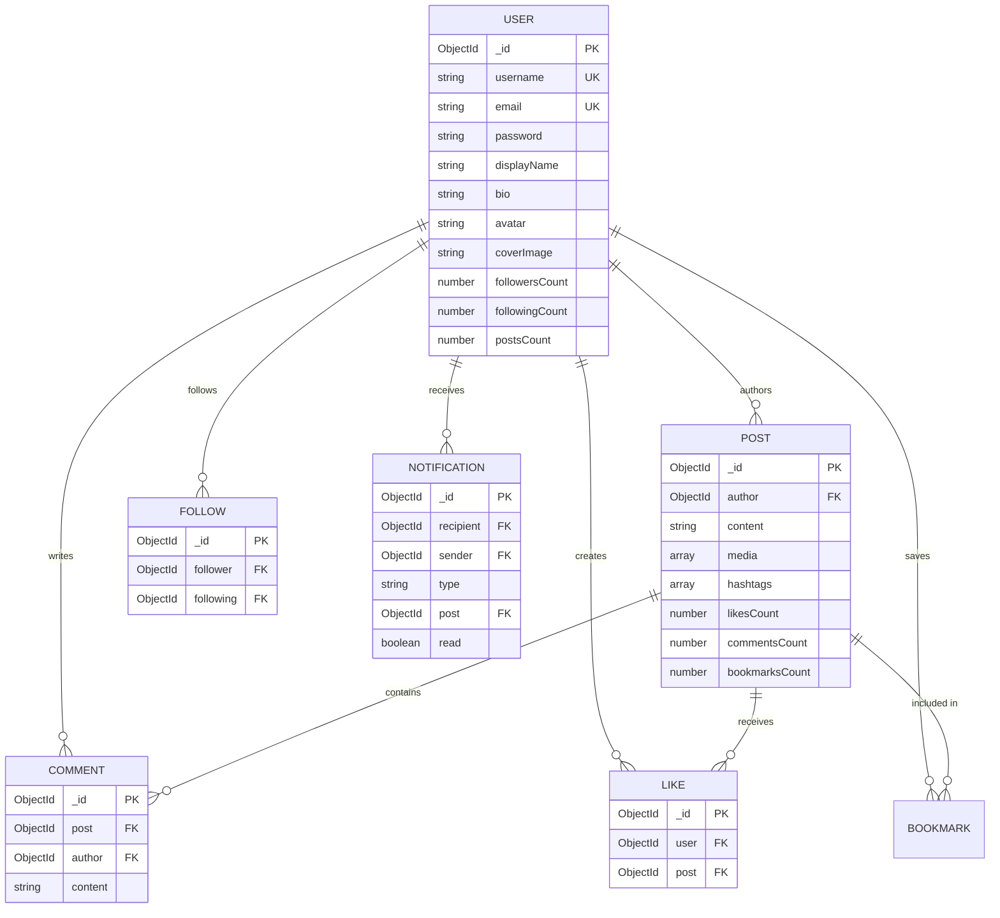

# ⚡ Connectify — Premium Full-Stack Social Networking Platform

[](https://opensource.org/licenses/MIT)
[](https://nodejs.org/)
[](https://reactjs.org/)
[](https://vitejs.dev/)
[](https://www.mongodb.com/)
[-success.svg)]()

> **CodeAlpha Social Media Platform Submission**  
> Suggested Repository Name: `CodeAlpha_SocialMediaPlatform`

Connectify is a modern, high-performance, full-stack social media web application designed with a polished user experience. Built with the **MERN** stack (MongoDB, Express, React, Node.js) with real-time **Socket.IO** events, **Tailwind CSS**, and **Vitest** test coverage.

---

## 🌟 Key Features

### 1. 🛡️ Authentication & User Accounts
- **Registration & Login**: Secure password hashing with bcryptjs (10 salt rounds), duplicate email and username validation.
- **JWT Session Security**: Secure tokens supporting both HttpOnly cookies and Bearer authorization headers.
- **Password Recovery**: Tokenized reset flow with expiration and SHA-256 verification.
- **Account Management**: Profile personalization (display name, bio, avatar, banner, website, location) and clean account deletion.
- **1-Click Demo Logins**: Instant access to pre-seeded fictional accounts for instant evaluation.

### 2. 📱 Interactive Social Feed
- **Rich Post Composer**: Compose thoughts, auto-detect `#hashtags`, attach up to 4 images with live preview thumbnails.
- **Algorithmic & Following Feeds**: Switch seamlessly between **For You** (trending & popular) and **Following** (curated followed creators).
- **Media Lightbox**: Fullscreen inspection of high-resolution images.
- **Optimistic Interactions**: Animated like button with heart burst micro-animation, dynamic count updates, and rollback on error.
- **Real-Time Commenting**: Slide-out comments drawer with live timestamp updates and authorization guards.
- **Bookmarking**: Save and organize favorite posts in a dedicated library.
- **Share Options**: One-click link copying and Web Share API integration.

### 3. 👥 Social Graph & Relationships
- **Follow / Unfollow**: Atomic follower and following counts, self-follow prevention, and unique compound indexing.
- **Dedicated User Lists**: Tabbed follower and following views with inline follow toggles.
- **Suggested Creators**: Automated recommendation engine matching active community members.

### 4. ⚡ Real-Time Socket.IO Notifications
- **Persisted Notifications**: Stored in MongoDB with read/unread flags and unread counter badges.
- **Live WebSocket Alerts**: Real-time push notifications for likes, comments, and new followers without refreshing.
- **Room Authorization**: Authenticated socket connections partitioned into private user rooms.

### 5. 🔍 Safe Search & Discovery
- **Safe Regex Search**: ReDoS-protected search for creators and post content.
- **Trending Topics**: Automated aggregation of top-used hashtags across the platform.

### 6. 🎨 World-Class Design & Accessibility
- **Curated Palette**: Electric violet, indigo, and rose accents over dark (`#0A0D14`) and light surfaces.
- **Theme Switcher**: Instant dark and light mode toggle with persisted preference.
- **Micro-Animations**: Smooth scale transitions, pulse badges, and skeleton loading placeholders.

---

## 🏗️ Architecture & Folder Structure

```
Connectify/
├── client/                     # FRONTEND (React 18 + Vite + Tailwind CSS)
│   ├── public/
│   ├── src/
│   │   ├── components/
│   │   │   ├── common/         # Avatar, Navbar, Sidebar, MobileNav, Modal, Skeleton
│   │   │   └── posts/          # PostCard, CreatePostCard, EditPostModal, CreatePostModal
│   │   ├── context/            # AuthContext, SocketContext, ToastContext
│   │   ├── layouts/            # MainLayout
│   │   ├── pages/              # Landing, Login, Register, Feed, Explore, Profile, Settings, etc.
│   │   ├── services/           # api.js fetch client
│   │   ├── styles/             # index.css design tokens & Tailwind utilities
│   │   ├── utils/              # formatDate.js
│   │   ├── App.jsx             # React Router routing tree
│   │   └── main.jsx            # Entry point
│   ├── tests/                  # Frontend Vitest & React Testing Library suites
│   ├── package.json
│   ├── tailwind.config.js
│   └── vite.config.js
│
├── server/                     # BACKEND (Node.js + Express + Mongoose + Socket.IO)
│   ├── src/
│   │   ├── config/             # Database connection with MongoMemoryServer fallback, env loader
│   │   ├── controllers/        # auth, user, post, like, comment, follow, bookmark, notification, search
│   │   ├── middleware/         # auth (protect/optionalAuth), upload (Multer), validate (Zod), errorHandler
│   │   ├── models/             # User, Post, Comment, Like, Bookmark, Follow, Notification
│   │   ├── routes/             # Feature-specific Express routers
│   │   ├── sockets/            # Socket.IO connection and notification dispatchers
│   │   ├── utils/              # jwt, seed script
│   │   ├── app.js              # Express app configuration & middleware
│   │   └── server.js           # HTTP + WebSocket server startup
│   ├── tests/                  # Backend Supertest & Vitest integration suites
│   ├── uploads/                # Local media storage directory
│   ├── package.json
│   └── vitest.config.js
│
├── docs/                       # API_DOCUMENTATION.md
├── scripts/                    # dev.js concurrently runner, verify-live.js
├── package.json                # Root scripts
└── README.md
```

---

## 🗄️ Database Models & Relationships



---

## 🚀 Quick Start & Installation

### Prerequisites
- Node.js (v18+ or v20+ recommended)
- npm (v9+)
- *(Optional)* Local MongoDB or MongoDB Atlas URI. **If no MongoDB is installed, Connectify automatically boots a zero-config in-memory database!**

### 1. Clone & Install Dependencies
```bash
# Clone the repository
git clone https://github.com/your-username/CodeAlpha_SocialMediaPlatform.git
cd CodeAlpha_SocialMediaPlatform

# Install root, backend, and frontend dependencies
npm run install:all
```

### 2. Configure Environment Variables

**Server Configuration (`server/.env`):**
```env
PORT=5000
NODE_ENV=development
CLIENT_URL=http://localhost:5173
MONGODB_URI=
JWT_SECRET=connectify_super_secret_jwt_key_2026_dev_mode_only!
JWT_EXPIRES_IN=7d
COOKIE_SECURE=false
```
*(Leave `MONGODB_URI` blank to use the built-in in-memory MongoDB, or paste your MongoDB Atlas connection string).*

**Client Configuration (`client/.env`):**
```env
VITE_API_URL=http://localhost:5000
```

### 3. Seed Sample Data
Populate the application with realistic fictional users, avatars, posts, comments, and relationships:
```bash
npm run seed
```

### 4. Start Development Servers
Start both the backend server (port 5000) and frontend client (port 5173) simultaneously:
```bash
npm run dev
```
Open **[http://localhost:5173](http://localhost:5173)** in your browser!

---

## 🔑 Demo Account Credentials

All pre-seeded demo accounts share the password: `Password123!`

| Handle | Name | Email | Role |
|---|---|---|---|
| `@alex_rivers` | Alex Rivers | alex@connectify.dev | Lead Frontend Architect (Verified) |
| `@sophia_chen` | Sophia Chen | sophia@connectify.dev | AI Researcher & Artist (Verified) |
| `@marcus_v` | Marcus Vance | marcus@connectify.dev | Full-Stack Craftsman |
| `@elena_rostova` | Elena Rostova | elena@connectify.dev | Creative Director (Verified) |
| `@dev_demo` | Connectify Explorer | demo@connectify.dev | General Test Account |

*The login page also provides 1-click login buttons for instant testing.*

---

## 🧪 Automated Testing

Connectify features a comprehensive automated test suite with **100% pass rate (23/23 tests passing)**.

### Run All Tests
```bash
npm run test
```

### Run Server API Tests (Supertest + Vitest)
```bash
npm run test:server
```
- Tests: Registration, duplicate validations, login, token authentication, post CRUD, like/unlike toggle, comment author checks, self-follow prevention, notification persistence, and `/api/health`.

### Run Client Component Tests (Testing Library + Vitest)
```bash
npm run test:client
```
- Tests: Auth page forms, Avatar initials rendering, Modal keyboard accessibility, ConfirmationModal handlers, and PostCard interaction states.

### Build Production Bundle
```bash
npm run build
```
Validates that TypeScript/JSX compiles cleanly and bundles assets without errors into `client/dist`.

---

## 📡 API Overview

Detailed documentation is available in [`docs/API_DOCUMENTATION.md`](docs/API_DOCUMENTATION.md).

- `POST /api/auth/register` — User signup
- `POST /api/auth/login` — User authentication
- `GET /api/auth/me` — Current user profile
- `GET /api/posts/feed` — Authenticated following feed
- `GET /api/posts/explore` — Global popular/trending feed
- `POST /api/posts` — Create new post with media
- `POST /api/posts/:id/like` — Toggle post like
- `POST /api/posts/:id/comments` — Add comment
- `POST /api/follows/:id` — Follow/unfollow creator
- `GET /api/notifications` — User notifications
- `GET /api/search?q=...` — Search creators and posts
- `POST /api/uploads` — Upload media attachments
- `GET /api/health` — Service health probe

---

## 🚢 Deployment Guidelines

### 1. Backend (Render / Railway)
- Root Directory: `server`
- Build Command: `npm install`
- Start Command: `node src/server.js`
- Environment Variables: Set `MONGODB_URI` (from MongoDB Atlas), `JWT_SECRET`, `CLIENT_URL`, `NODE_ENV=production`.

### 2. Frontend (Vercel / Netlify)
- Root Directory: `client`
- Build Command: `npm run build`
- Output Directory: `dist`
- Environment Variables: Set `VITE_API_URL` to your production backend URL.

---

## 🔒 Security Summary

- **Password Security**: Strong hashing with bcryptjs (10 salt rounds), never stored or returned in plaintext.
- **NoSQL Injection Defense**: Strict Mongoose schemas and sanitized query objects.
- **Cross-Site Scripting (XSS)**: Escaped input fields, React JSX escaping, and HTTP security headers via Helmet.
- **Rate Limiting**: Configured `express-rate-limit` on API endpoints to mitigate brute force and abuse.
- **Authorization**: Edits and deletions enforced strictly on the server by validating `req.user._id` against resource owner.
- **WebSocket Protection**: Handshake token verification before joining private user notification rooms.

---

## 📄 License
This project is licensed under the [MIT License](LICENSE).
Built with ❤️ for the CodeAlpha Social Media Platform internship project.
